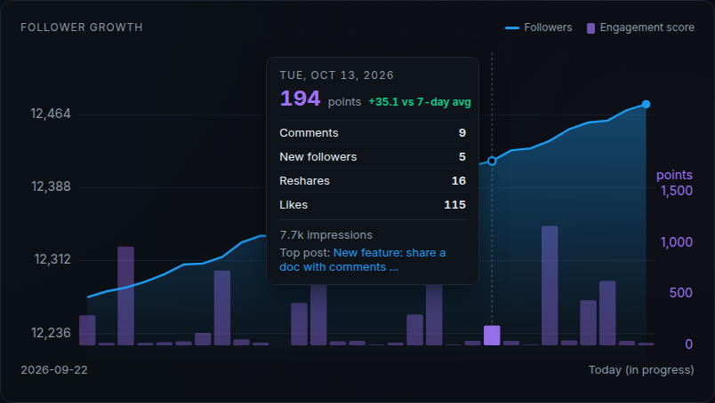
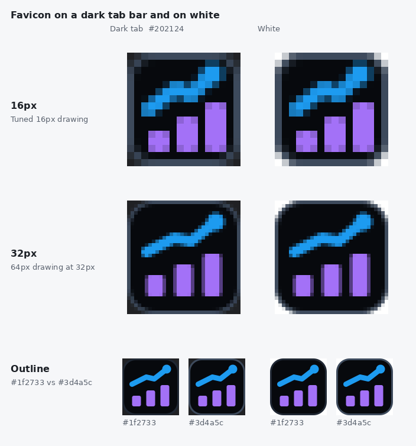
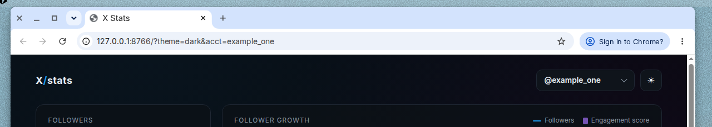
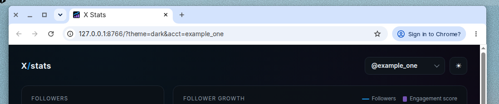

# xstats

A small, self-hosted X (Twitter) stats dashboard. Track follower growth and per-post metrics (impressions, likes, replies, reposts) for one or more accounts, with daily history and a per-post drill-in. Ships as a single Go binary.




## Features

- Account switcher for any number of accounts
- Current follower count with 7 and 30 day deltas
- Follower growth chart built from daily snapshots, with a daily engagement-score bar
- Recent posts table (last 30 days), retweets excluded, replies hidden behind a toggle
- Per-post drill-in with impressions, likes, replies and reposts over time
- Light and dark themes (follows the system, remembers your choice), responsive down to phone width
- Optional "clickthroughs from X" card if you feed in referral visit counts

| Post drill-in | Mobile, light |
|---|---|
|  |  |

## Architecture

```
  your snapshot job                 server
 (any X API client)     HTTPS    +-------------------------------+
  raw JSON bundle  ------------> | Caddy (TLS, basic auth)       |
  POST /api/ingest   Bearer      |   /api/ingest: token only     |
  GET  /api/health   Bearer      |   /api/health: token only     |
                                 |   favicons: public            |
                                 |   everything else: basic auth |
                                 |            |                  |
                                 |   xstats serve (127.0.0.1)    |
                                 |   embedded frontend + API     |
                                 |            |                  |
                                 |   SQLite (xstats.db)          |
                                 +-------------------------------+
```

- **One binary.** `xstats` embeds the static frontend with `go:embed` and uses `modernc.org/sqlite`, so it builds with `CGO_ENABLED=0` and has no runtime dependencies.
- **SQLite.** Tables: `accounts` (`last_ingest` is set on each successful ingest and stays null until then), `follower_snapshots` (one row per account per day), `post_metrics` (one row per post per day), `clickthroughs` (one row per day). `post_metrics.source` is `live` for a snapshot bundle and `archive` for an archive import. Re-ingesting a day replaces that day's live rows. Importing an archive again does not add a second archive row.
- **Ingest API.** `POST /api/ingest` with `Authorization: Bearer <token>` accepts a snapshot bundle. The token comes from `XSTATS_INGEST_TOKEN`; if it is unset, ingest is disabled.
- **Health.** `GET /api/health` uses that same bearer token. If `XSTATS_INGEST_TOKEN` is unset, every health request is refused, same as ingest. A 200 body is JSON with `version`, `commit`, `server_time` (RFC3339, UTC), and `accounts`. Each account has only `latest_snapshot_date` and `last_ingest` (`last_ingest` is null until a successful ingest records it). No post text and no follower counts or other metrics. Example: `curl -sH "Authorization: Bearer $XSTATS_INGEST_TOKEN" http://127.0.0.1:8080/api/health`.
- **Read API.** `GET /api/data` (accounts, follower history, daily engagement, recent posts) and `GET /api/post/<id>` (daily history for one post).
- **Caddy** terminates TLS with automatic certificates and puts basic auth in front of the dashboard. `/api/ingest` and `/api/health` are open to the bearer token and do not require basic auth. Favicon paths and `site.webmanifest` are open too: they are static files with no account data, and browsers request them without the dashboard credentials.

xstats does not call the X API itself. Collect data with whatever client you like and hand it the raw JSON.

## Build

Requires Go 1.23+.

```
go test ./...
CGO_ENABLED=0 GOOS=linux GOARCH=amd64 go build -o bin/xstats ./cmd/xstats
```

A release build stamps the version and commit that `xstats version` prints:

```
CGO_ENABLED=0 GOOS=linux GOARCH=amd64 go build -trimpath -ldflags "-X main.version=$(git describe --tags --always) -X main.commit=$(git rev-parse HEAD)" -o bin/xstats ./cmd/xstats
```

Without those `-X` flags the command prints `dev` and the commit from Go's embedded build info (`vcs.revision`, with `-dirty` when `vcs.modified` is true), or `unknown` when no commit is available.

Pushing a `v*` tag publishes a [GitHub release](https://github.com/scott/xstats/releases) with `CGO_ENABLED=0` binaries for linux/amd64 and linux/arm64 (`xstats-linux-amd64`, `xstats-linux-arm64`), `xstats.service`, `Caddyfile.tmpl`, `set-auth.sh` (`bootstrap.sh` when that file is in the repo), and a `SHA256SUMS` file. The release stamps `main.version` with the tag and `main.commit` with the commit. Download the assets and `SHA256SUMS` into the same directory, then verify:

```
sha256sum -c SHA256SUMS
```

`scripts/build-release.sh <version> <commit> <outdir>` is the build the release workflow runs. It passes `-trimpath` so local paths are not embedded in the binaries.

## Favicon

The mark is a growth chart on a `#07090d` tile: bars `#a371f7`, line and dot `#1d9bf0` (the `--bar` and `--acc` values in `cmd/xstats/web/index.html`). The outline is `#3d4a5c`, lighter than the page border `#1f2733`, so the tile still shows up on a dark browser tab and still reads on a light one.

`scripts/favicon/mark.svg` is the 64px drawing used for the 32, 48, 192, and 512 PNGs and for the Apple touch icon. Shrinking that drawing to 16px turns the 2px stroke into a half pixel and softens the bars, so `scripts/favicon/mark-16.svg` is a separate 16px drawing: a 1px outline, a 2px line, and pixel-aligned bars. `favicon.svg` and `favicon-16.png` use that drawing. The Apple touch icon is a full-bleed tile, because iOS rounds the square itself.

Rebuild the rasters with `rsvg-convert` (package `librsvg2-bin`):

```
scripts/render-favicons.py
```

`favicon.ico` contains the 16, 32, and 48 PNGs. `site.webmanifest` lists the 192 and 512 icons and sets `theme_color` to `#07090d`.



Browser tab on fake demo data (`example_one`), before the icon and after:





## Run locally

```
bin/xstats ingest --db data/xstats.db snapshot.json
bin/xstats serve  --db data/xstats.db --addr 127.0.0.1:8080
```

Open http://127.0.0.1:8080. Handy URL options: `?theme=dark|light`, `?acct=<handle>`, `#post/<id>`.

Those commands run in the foreground. For a dashboard that stays up on this machine, see [Local only](#local-only).

## Demo with fake data

`scripts/seed.py` writes 30 days of made-up snapshots for two fictional accounts (`example_one`, `example_two`). The screenshots in this README come from it.

```
scripts/seed.py /tmp/seed 30
bin/xstats ingest --db /tmp/demo.db /tmp/seed/*.json
bin/xstats serve  --db /tmp/demo.db --addr 127.0.0.1:8080
```

## Snapshot format

One JSON file per day. The `user` and `posts` objects are the X API v2 responses as returned, so you can save them without reshaping.

```json
{
  "date": "2026-10-14",
  "accounts": {
    "example": {
      "user":  { "id": "123", "username": "example", "name": "Example",
                 "profile_image_url": "https://...",
                 "public_metrics": { "followers_count": 100, "following_count": 50, "tweet_count": 400 } },
      "posts": [ { "id": "1846...", "text": "Hello", "created_at": "2026-10-14T15:00:00.000Z",
                   "in_reply_to_user_id": "",
                   "public_metrics": { "impression_count": 120, "like_count": 4, "reply_count": 1,
                                       "retweet_count": 2, "quote_count": 0 } } ]
    }
  },
  "clickthroughs": { "visits": 12 }
}
```

- `date` defaults to today if omitted. `clickthroughs` is optional.
- Posts starting with `RT @` are skipped. Posts starting with `@` or with `in_reply_to_user_id` are flagged as replies.
- Reposts shown in the UI are `retweet_count + quote_count`.
- A missing `impression_count` is stored as NULL and shown as a dash. `impression_count: 0` is stored as 0. NULL is left out of impression totals.

## Archive import

`xstats import-archive` reads an X data archive and writes posts straight into the database. Pass the zip, or the extracted folder that contains `data/`. This command does not call the X API, and there is no server ingest path for an archive yet.

```
bin/xstats import-archive --db data/xstats.db ~/Downloads/x-archive.zip
bin/xstats import-archive --db data/xstats.db --account example ~/Downloads/x-archive
```

The handle comes from `data/account.js` (`account.username`) when that file is present. If it is missing, `--account` is required. If both are set, they have to match. The stored handle is lowercased, and a leading `@` is stripped.

`data/tweets.js` and `data/tweets-part*.js` are JSON arrays assigned with `window.YTD.tweets.partN = `. Each item is `{"tweet": {...}}`. The importer reads `id_str`, `created_at` (`Wed Oct 10 20:19:24 +0000 2018`, stored as RFC3339 UTC), `full_text`, `favorite_count` (likes), and `retweet_count` (reposts). Counts in the archive are strings. Impressions and replies are NULL. There is no separate quotes column, so unknown quotes are not added into reposts, which stay the known `retweet_count`. A post is a reply when `full_text` starts with `@` or any `in_reply_to_*` string is non-empty. Posts whose text starts with `RT @` are skipped.

Rows are tagged `source = 'archive'` and dated the import day in `XSTATS_TZ` (the same zone the dashboard uses for today, not a fixed Mountain Time). One archive row is kept per post. A later import does not update that row and does not insert another one. A post that already has any live snapshot is left completely alone, including when the archive row would have been dated later than the live one. The drill-in then lists only the live snapshots, and the latest-snapshot queries pick the newest live row.

A missing required field, a wrong JSON type, or an unexpected `window.YTD` prefix fails the import, names the file, item, and field, and writes nothing.

`data/note-tweet.js` is not read. A long post keeps the `full_text` from `tweets.js`.

This has not been checked against a real X archive. The field names come from public documentation of the archive format.

## Engagement score

Each follower-history day on `GET /api/data` includes an `engagement` object. Existing history fields are unchanged. The response also includes the weights once:

```json
"engagement_weights": {"comments": 3, "new_followers": 4, "reshares": 2, "likes": 1}
```

```
score = 3×comments + 4×new_followers + 2×reshares + 1×likes
```

`points` is the same total, kept for clients that already read it. Impressions stay on the day and in the hover card as context; they do not scale the score.

- **comments** are `reply_count`. **likes** are `like_count`. **reshares** are the stored `reposts` value. Live ingest stores `retweet_count + quote_count`. An archive row stores the known `retweet_count` only. An unknown reply count is left out of the score. When every post that day has an unknown reply count, comments are null and the hover shows a dash. A known 0 stays 0. A day with no posts still reports 0.
- Posts are summed on the calendar day of `created_at` in `XSTATS_TZ` (default `America/Denver`), the day the hourly ingest closes. A post at 23:30 Mountain Time is 05:30 UTC the next morning and still counts on the Mountain Time day. A bare `YYYY-MM-DD` is that calendar day and is not shifted. The recent-posts list is still the last 30 UTC days. Each post is counted once, from its latest snapshot, so re-pushing a day replaces that snapshot instead of double-counting. The chart runs from the first follower snapshot through the last, one bar slot per calendar day, centered on that day's follower point. The right axis is integer points. A day with no snapshot, or a score of 0 or below, keeps the slot and draws no bar.
- **new_followers** is the change from the previous follower snapshot. The first snapshot has no prior day, so new followers are 0.
- A day with 0 impressions still has a score. A follower drop can make the score negative; the card shows that value and the chart draws no bar.
- If the source omitted `impression_count`, that post is not added into the day's impression total. When every post that day omitted it, the total is null and the hover card shows a dash. A day with no posts still reports 0.
- `in_progress` is true when that snapshot date is today in `XSTATS_TZ`, because the day can still be re-pushed. The page labels the browser's local today as "Today (in progress)", same as the follower line.
- `score_delta` is this score minus the average score of earlier snapshot days in the previous 7 calendar days. Zero and negative scores are included.
- `top_post` is the post created that day with the most post-level points (`3×replies + 2×reshares + 1×likes`). Ties prefer more impressions, then the lower post id. The link is `https://x.com/<handle>/status/<id>`.

Suggested X API v2 calls per day (3 reads for two accounts):

- `GET /2/users/by?usernames=a,b&user.fields=public_metrics,profile_image_url,name`
- `GET /2/users/:id/tweets?max_results=50&tweet.fields=public_metrics,created_at,in_reply_to_user_id` per account

Push a day to a running server:

```
STATS_URL=https://stats.example.com snapshot/push.sh snapshot-2026-10-14.json
```

`push.sh` reads the token from `~/.config/xstats/ingest_token` (override with `XSTATS_TOKEN_FILE`) and passes it to curl on stdin, never on the command line.

## Local only

A long-lived dashboard on one machine, with no server and no Caddy. `xstats serve` is bound to `127.0.0.1:8080` and runs as a systemd user service.

What you give up: there is no public URL and no TLS, and the dashboard is viewable only on that machine. Nothing sits in front of the process, so there is no basic auth either. The loopback bind is what keeps it private. Open http://127.0.0.1:8080 on that machine.

1. Build the binary into a stable path and create the data directory:

   ```
   install -d -m 0755 ~/.local/bin
   install -d -m 0700 ~/.local/share/xstats ~/.config/xstats
   CGO_ENABLED=0 go build -o ~/.local/bin/xstats ./cmd/xstats
   ```

2. Create the ingest token and a mode-0600 env file. `openssl` writes the token to `~/.config/xstats/ingest_token`. The env file is built from that file with `cat`, so the token is never inline in the unit, in argv, or in shell history. The service reads `XSTATS_INGEST_TOKEN` from the env file. `snapshot/push.sh` reads the token file (`XSTATS_TOKEN_FILE` overrides that path; the default is `~/.config/xstats/ingest_token`).

   ```
   (umask 077; openssl rand -hex 32 > ~/.config/xstats/ingest_token)
   (umask 077; { printf 'XSTATS_INGEST_TOKEN='; cat ~/.config/xstats/ingest_token; echo; } > ~/.config/xstats/local.env)
   chmod 600 ~/.config/xstats/ingest_token ~/.config/xstats/local.env
   ```

   `XSTATS_TZ` is optional. Leave it unset and engagement days use `America/Denver` (zone data is embedded; see the table under Deploy). To override, add one line to that same env file, for example `XSTATS_TZ=America/New_York`. Keep the file mode 0600.

3. Install the user unit. The same file is `deploy/xstats-local.service`:

   ```
   [Unit]
   Description=xstats local dashboard
   After=network.target

   [Service]
   EnvironmentFile=%h/.config/xstats/local.env
   ExecStart=%h/.local/bin/xstats serve --db %h/.local/share/xstats/xstats.db --addr 127.0.0.1:8080
   Restart=on-failure

   [Install]
   WantedBy=default.target
   ```

   `%h` is the home directory of the user who owns the service. The unit has no secret in it; `EnvironmentFile=` loads the token.

   ```
   mkdir -p ~/.config/systemd/user
   install -m 0644 deploy/xstats-local.service ~/.config/systemd/user/xstats.service
   systemctl --user daemon-reload
   systemctl --user enable --now xstats.service
   loginctl enable-linger "$USER"
   ```

   `loginctl enable-linger` starts the user service manager at boot and leaves it running after logout, so the dashboard comes back without a login. This unit is per user. The system unit in `deploy/xstats.service` is the one Deploy installs on a server.

4. Feed it with `xstats ingest` or with `snapshot/push.sh` against localhost. A snapshot bundle is one JSON file (see Snapshot format). `scripts/seed.py` writes fake bundles for a demo.

   Into the same database the service has open:

   ```
   ~/.local/bin/xstats ingest --db ~/.local/share/xstats/xstats.db snapshot.json
   ```

   Or POST to the running server. `push.sh` takes one file and reads the token file from step 2. `STATS_URL` is required.

   Warning: if `~/.config/xstats/deploy.env` exists (e.g. on a machine that also deploys), `push.sh` currently lets its `STATS_URL` override yours, so a local push can go to your server. Until #22 is fixed, set `XSTATS_DEPLOY_ENV=/dev/null` for local pushes or remove `deploy.env`.

   ```
   XSTATS_DEPLOY_ENV=/dev/null STATS_URL=http://127.0.0.1:8080 snapshot/push.sh snapshot.json
   ```

### Moving to a server

Follow [Deploy](#deploy) when you want a public site. Use `xstats.<your domain>` as the hostname (`XSTATS_DOMAIN`), for example `xstats.example.com`.

Stop the local service, then copy the SQLite file. With the service stopped, either a plain copy or the `sqlite3` shell `.backup` is a consistent copy of `~/.local/share/xstats/xstats.db`:

```
systemctl --user stop xstats.service
cp ~/.local/share/xstats/xstats.db /tmp/xstats.db
```

```
systemctl --user stop xstats.service
sqlite3 ~/.local/share/xstats/xstats.db ".backup /tmp/xstats.db"
```

On the server, Deploy has created the `xstats` user and `/var/lib/xstats` (see `deploy/xstats.service`). Stop that system service, copy the file over the server database, and fix ownership so the `xstats` user can write it. This replaces `/var/lib/xstats/xstats.db`:

```
scp /tmp/xstats.db "root@$XSTATS_HOST:/tmp/xstats.db"
ssh "root@$XSTATS_HOST" 'systemctl stop xstats && cp /tmp/xstats.db /var/lib/xstats/xstats.db && chown xstats:xstats /var/lib/xstats/xstats.db && systemctl start xstats'
```

## Install on a fresh server

`deploy/bootstrap.sh` installs a release on Ubuntu 22.04 or 24.04. Run it as root on the server. It detects `amd64` or `arm64`, downloads that binary and `SHA256SUMS` from the latest GitHub release, and stops if the checksum is missing or wrong. It creates the `xstats` user, installs `xstats.service`, installs Caddy from Caddy's official apt repository, and renders `Caddyfile.tmpl` by running `set-auth.sh`. The dashboard env file is `/etc/xstats/env`, mode 0640, owner root, group xstats.

Point a DNS A record at the server first. The usual name is `xstats.<domain>`, for example `xstats.example.com`. With no hostname set, the prompt asks for the domain and suggests that name.

Pass the ingest token and the dashboard password in files or at the prompt. Create the files on the server with mode 0600:

```
(umask 077; openssl rand -hex 32 > /root/ingest_token)
```

Put the dashboard password in `/root/dash_pass` the same way, or leave `--password-file` off and type it when asked.

Pipe the installer:

```
curl -fsSL https://github.com/scott/xstats/releases/latest/download/bootstrap.sh | sudo bash -s -- \
  --hostname xstats.example.com \
  --accounts alice,bob \
  --token-file /root/ingest_token \
  --password-file /root/dash_pass
```

Download it, read it, then run it:

```
curl -fsSL -o bootstrap.sh https://github.com/scott/xstats/releases/latest/download/bootstrap.sh
less bootstrap.sh
sudo bash bootstrap.sh \
  --hostname xstats.example.com \
  --token-file /root/ingest_token \
  --password-file /root/dash_pass
```

Over SSH, from a checkout of this repo:

```
ssh root@203.0.113.10 'bash -s -- --hostname xstats.example.com --token-file /root/ingest_token --password-file /root/dash_pass' < deploy/bootstrap.sh
```

A copy of the script that is not sitting next to `set-auth.sh`, `Caddyfile.tmpl`, and `xstats.service` downloads those three files from the same release URL as the binary and checks each one against `SHA256SUMS`. A missing entry, a duplicate entry, a mismatch, or an empty file stops the install before anything is installed. `deploy/bootstrap.sh` in a checkout uses the copies beside it.

| Input | Default | Meaning |
|---|---|---|
| `--hostname` / `XSTATS_DOMAIN` | prompt | Dashboard hostname. The prompt suggests `xstats.<domain>` |
| `--accounts` / `XSTATS_ACCOUNTS` | empty | Optional tab order, for example `alice,bob` |
| `--auth-user` / `XSTATS_AUTH_USER` | `admin` | Dashboard username |
| `--tz` / `XSTATS_TZ` | omitted | Optional zone written to `/etc/xstats/env` |
| `--token-file` / `XSTATS_TOKEN_FILE` | prompt or stdin | File containing the ingest token |
| `--password-file` / `XSTATS_PASSWORD_FILE` | prompt or stdin | File containing the dashboard password |
| `--release-url` / `XSTATS_RELEASE_URL` | latest GitHub release | Base URL for the binary, `xstats.service`, `Caddyfile.tmpl`, `set-auth.sh`, and `SHA256SUMS` |

When `XSTATS_TZ` is set, the script trims whitespace and checks the zone before it creates the user, installs packages, or writes xstats files. An invalid zone stops the install. When `XSTATS_TZ` is unset or blank, the line is left out of `/etc/xstats/env` and the binary keeps its own default.

Running the script again is safe. The previous binary stays at `/usr/local/bin/xstats.prev`, and an existing database is copied to `/var/lib/xstats/xstats.db.bak-<timestamp>` before the new binary is installed. An ingest token already in `/etc/xstats/env` is kept unless you pass `--token-file` or `--rotate-token`.

## Deploy

Target: a fresh Ubuntu 22.04 or 24.04 server (512 MB is plenty). Nothing is compiled on the server.

1. Point a DNS A record (for example `stats.example.com`) at the server's IPv4 address. Caddy needs this to get a certificate.
2. Create an ingest token on your machine:
   ```
   mkdir -p ~/.config/xstats && (umask 077; openssl rand -hex 32 > ~/.config/xstats/ingest_token)
   ```
3. Build, then deploy:
   ```
   CGO_ENABLED=0 GOOS=linux GOARCH=amd64 go build -o bin/xstats ./cmd/xstats
   read -rs BASIC_AUTH_PASSWORD && export BASIC_AUTH_PASSWORD
   XSTATS_HOST=203.0.113.10 XSTATS_DOMAIN=stats.example.com SSH_KEY=~/.ssh/id_ed25519 deploy/deploy.sh
   unset BASIC_AUTH_PASSWORD
   ```

Put these in `~/.config/xstats/deploy.env` (mode 0600, see `.env.deploy.example`) so `deploy.sh` and `push.sh` pick them up automatically. Keep `BASIC_AUTH_PASSWORD` out of that file and export it only when deploying.

| Variable | Default | Meaning |
|---|---|---|
| `XSTATS_HOST` | required | Server IP or hostname for SSH |
| `XSTATS_DOMAIN` | required | Public hostname served by Caddy |
| `BASIC_AUTH_PASSWORD` | required | Dashboard password |
| `XSTATS_AUTH_USER` | `admin` | Dashboard username |
| `XSTATS_SSH_USER` | `root` | SSH user |
| `SSH_KEY` | `~/.ssh/id_ed25519` | SSH private key path |
| `XSTATS_TOKEN_FILE` | `~/.config/xstats/ingest_token` | Ingest token file |
| `XSTATS_ACCOUNTS` | unset | Optional tab order, e.g. `alice,bob`; first is the default |
| `XSTATS_TZ` | `America/Denver` | Zone for engagement day buckets and `in_progress`. `deploy.sh` propagates it to `/etc/xstats/env` when set, and omits the line when unset so the binary default applies. An invalid name fails the deploy before the server is touched. Zone data is embedded, so a host without tz files still resolves the default |
| `STATS_URL` | required for push | Base URL used by `snapshot/push.sh` |

`deploy.sh` installs Caddy from its official apt repo, creates an `xstats` system user, installs the binary to `/usr/local/bin`, the unit from `deploy/xstats.service`, and `/etc/xstats/env` (mode 0640) with the ingest token, `XSTATS_ACCOUNTS`, and `XSTATS_TZ` when that zone is set. The password is sent over SSH stdin and hashed on the server with `caddy hash-password`; only the bcrypt hash is stored. The script is idempotent.

Each deploy keeps the previous binary as `/usr/local/bin/xstats.prev` and backs up the database to `/var/lib/xstats/xstats.db.bak-<timestamp>`.

To update only the binary later:

```
scp bin/xstats root@$XSTATS_HOST:/tmp/xstats.new
ssh root@$XSTATS_HOST 'install -m 0755 /tmp/xstats.new /usr/local/bin/xstats && systemctl restart xstats'
```

## Mockup

`mockup/` holds the original static design with example data.

## License

MIT, see [LICENSE](LICENSE).
