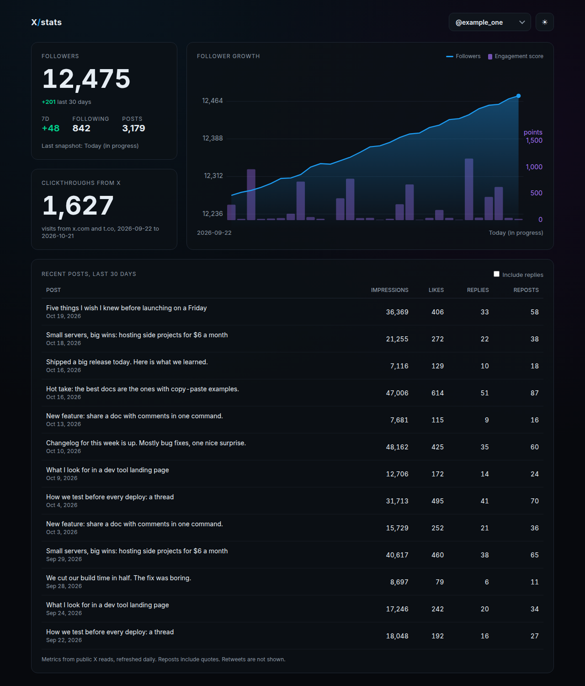
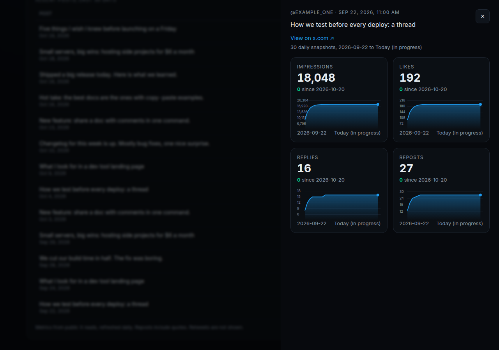
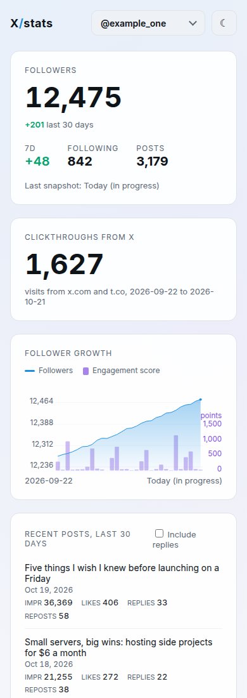

# xstats

A small, self-hosted X (Twitter) stats dashboard. Track follower growth and per-post metrics (impressions, likes, replies, reposts) for one or more accounts, with daily history and a per-post drill-in. Ships as a single Go binary.



## Features

- Account switcher for any number of accounts
- Current follower count with 7 and 30 day deltas
- Follower growth chart built from daily snapshots, with a daily engagement-score bar
- Recent posts table (last 30 days), retweets excluded, replies hidden behind a toggle
- Per-post drill-in with impressions, likes, replies and reposts over time
- Light and dark themes (follows the system, remembers your choice), responsive down to phone width
- Optional "clickthroughs from X" card if you feed in referral visit counts

| Post drill-in | Mobile, light |
|---|---|
|  |  |

## Architecture

```
  your snapshot job                 server
 (any X API client)     HTTPS    +-------------------------------+
  raw JSON bundle  ------------> | Caddy (TLS, basic auth)       |
  POST /api/ingest   Bearer      |   /api/ingest: token only     |
                                 |   everything else: basic auth |
                                 |            |                  |
                                 |   xstats serve (127.0.0.1)    |
                                 |   embedded frontend + API     |
                                 |            |                  |
                                 |   SQLite (xstats.db)          |
                                 +-------------------------------+
```

- **One binary.** `xstats` embeds the static frontend with `go:embed` and uses `modernc.org/sqlite`, so it builds with `CGO_ENABLED=0` and has no runtime dependencies.
- **SQLite.** Tables: `accounts`, `follower_snapshots` (one row per account per day), `post_metrics` (one row per post per day), `clickthroughs` (one row per day). Re-ingesting a day upserts, so it is always safe to rerun.
- **Ingest API.** `POST /api/ingest` with `Authorization: Bearer <token>` accepts a snapshot bundle. The token comes from `XSTATS_INGEST_TOKEN`; if it is unset, ingest is disabled.
- **Read API.** `GET /api/data` (accounts, follower history, daily engagement, recent posts) and `GET /api/post/<id>` (daily history for one post).
- **Caddy** terminates TLS with automatic certificates and puts basic auth in front of everything except `/api/ingest`.

xstats does not call the X API itself. Collect data with whatever client you like and hand it the raw JSON.

## Build

Requires Go 1.23+.

```
go test ./...
CGO_ENABLED=0 GOOS=linux GOARCH=amd64 go build -o bin/xstats ./cmd/xstats
```

## Run locally

```
bin/xstats ingest --db data/xstats.db snapshot.json
bin/xstats serve  --db data/xstats.db --addr 127.0.0.1:8080
```

Open http://127.0.0.1:8080. Handy URL options: `?theme=dark|light`, `?acct=<handle>`, `#post/<id>`.

## Demo with fake data

`scripts/seed.py` writes 30 days of made-up snapshots for two fictional accounts (`example_one`, `example_two`). The screenshots in this README come from it.

```
scripts/seed.py /tmp/seed 30
bin/xstats ingest --db /tmp/demo.db /tmp/seed/*.json
bin/xstats serve  --db /tmp/demo.db --addr 127.0.0.1:8080
```

## Snapshot format

One JSON file per day. The `user` and `posts` objects are the X API v2 responses as returned, so you can save them without reshaping.

```json
{
  "date": "2026-10-14",
  "accounts": {
    "example": {
      "user":  { "id": "123", "username": "example", "name": "Example",
                 "profile_image_url": "https://...",
                 "public_metrics": { "followers_count": 100, "following_count": 50, "tweet_count": 400 } },
      "posts": [ { "id": "1846...", "text": "Hello", "created_at": "2026-10-14T15:00:00.000Z",
                   "in_reply_to_user_id": "",
                   "public_metrics": { "impression_count": 120, "like_count": 4, "reply_count": 1,
                                       "retweet_count": 2, "quote_count": 0 } } ]
    }
  },
  "clickthroughs": { "visits": 12 }
}
```

- `date` defaults to today if omitted. `clickthroughs` is optional.
- Posts starting with `RT @` are skipped. Posts starting with `@` or with `in_reply_to_user_id` are flagged as replies.
- Reposts shown in the UI are `retweet_count + quote_count`.

## Engagement score

Each follower-history day on `GET /api/data` includes an `engagement` object. Existing history fields are unchanged. The response also includes the weights once:

```json
"engagement_weights": {"comments": 3, "new_followers": 4, "reshares": 2, "likes": 1}
```

```
score = (3×comments + 4×new_followers + 2×reshares + 1×likes) / (impressions/1000)
```

- **comments** are `reply_count`. **likes** are `like_count`. **reshares** are `retweet_count + quote_count`, the value already stored in `post_metrics.reposts`.
- Posts are summed on the UTC calendar day of `created_at`, the same clock as the 30-day posts window. Each post is counted once, from its latest snapshot, so re-pushing a day replaces that snapshot instead of double-counting. The chart's x-axis is still the follower snapshot dates; a post whose UTC day has no snapshot is not drawn.
- **new_followers** is the change from the previous follower snapshot. The first snapshot has no prior day, so new followers are 0.
- When a day's impressions are 0, `score` is null and the chart draws no bar. The hover card says so.
- `in_progress` is true when that snapshot date is the server's local today, because the day can still be re-pushed. The page labels the browser's local today as "Today (in progress)", same as the follower line.
- `score_delta` is this score minus the average score of earlier snapshot days in the previous 7 calendar days. Days with no score are left out of the average.
- `top_post` is the post created that day with the most post-level points (`3×replies + 2×reshares + 1×likes`). Ties prefer more impressions, then the lower post id. The link is `https://x.com/<handle>/status/<id>`.

Suggested X API v2 calls per day (3 reads for two accounts):

- `GET /2/users/by?usernames=a,b&user.fields=public_metrics,profile_image_url,name`
- `GET /2/users/:id/tweets?max_results=50&tweet.fields=public_metrics,created_at,in_reply_to_user_id` per account

Push a day to a running server:

```
STATS_URL=https://stats.example.com snapshot/push.sh snapshot-2026-10-14.json
```

`push.sh` reads the token from `~/.config/xstats/ingest_token` (override with `XSTATS_TOKEN_FILE`) and passes it to curl on stdin, never on the command line.

## Deploy

Target: a fresh Ubuntu 22.04 or 24.04 server (512 MB is plenty). Nothing is compiled on the server.

1. Point a DNS A record (for example `stats.example.com`) at the server's IPv4 address. Caddy needs this to get a certificate.
2. Create an ingest token on your machine:
   ```
   mkdir -p ~/.config/xstats && (umask 077; openssl rand -hex 32 > ~/.config/xstats/ingest_token)
   ```
3. Build, then deploy:
   ```
   CGO_ENABLED=0 GOOS=linux GOARCH=amd64 go build -o bin/xstats ./cmd/xstats
   read -rs BASIC_AUTH_PASSWORD && export BASIC_AUTH_PASSWORD
   XSTATS_HOST=203.0.113.10 XSTATS_DOMAIN=stats.example.com SSH_KEY=~/.ssh/id_ed25519 deploy/deploy.sh
   unset BASIC_AUTH_PASSWORD
   ```

Put these in `~/.config/xstats/deploy.env` (mode 0600, see `.env.deploy.example`) so `deploy.sh` and `push.sh` pick them up automatically. Keep `BASIC_AUTH_PASSWORD` out of that file and export it only when deploying.

| Variable | Default | Meaning |
|---|---|---|
| `XSTATS_HOST` | required | Server IP or hostname for SSH |
| `XSTATS_DOMAIN` | required | Public hostname served by Caddy |
| `BASIC_AUTH_PASSWORD` | required | Dashboard password |
| `XSTATS_AUTH_USER` | `admin` | Dashboard username |
| `XSTATS_SSH_USER` | `root` | SSH user |
| `SSH_KEY` | `~/.ssh/id_ed25519` | SSH private key path |
| `XSTATS_TOKEN_FILE` | `~/.config/xstats/ingest_token` | Ingest token file |
| `XSTATS_ACCOUNTS` | unset | Optional tab order, e.g. `alice,bob`; first is the default |
| `STATS_URL` | required for push | Base URL used by `snapshot/push.sh` |

`deploy.sh` installs Caddy from its official apt repo, creates an `xstats` system user, installs the binary to `/usr/local/bin`, the unit from `deploy/xstats.service`, and the token in `/etc/xstats/env` (mode 0640). The password is sent over SSH stdin and hashed on the server with `caddy hash-password`; only the bcrypt hash is stored. The script is idempotent.

Each deploy keeps the previous binary as `/usr/local/bin/xstats.prev` and backs up the database to `/var/lib/xstats/xstats.db.bak-<timestamp>`.

To update only the binary later:

```
scp bin/xstats root@$XSTATS_HOST:/tmp/xstats.new
ssh root@$XSTATS_HOST 'install -m 0755 /tmp/xstats.new /usr/local/bin/xstats && systemctl restart xstats'
```

## Mockup

`mockup/` holds the original static design with example data.

## License

MIT, see [LICENSE](LICENSE).
